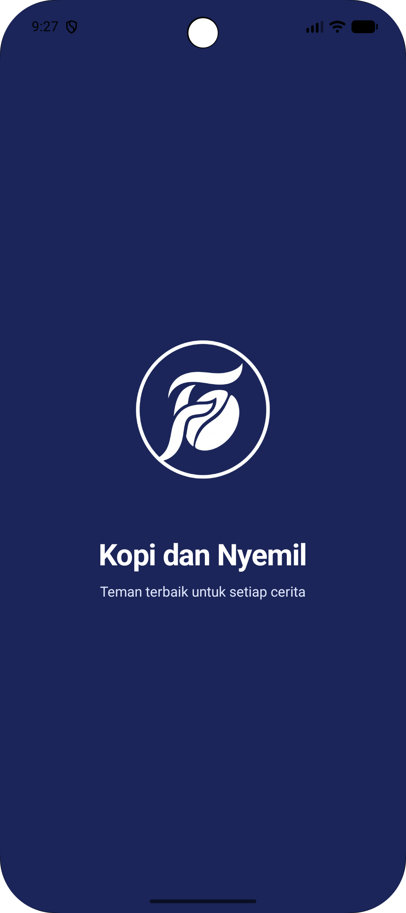
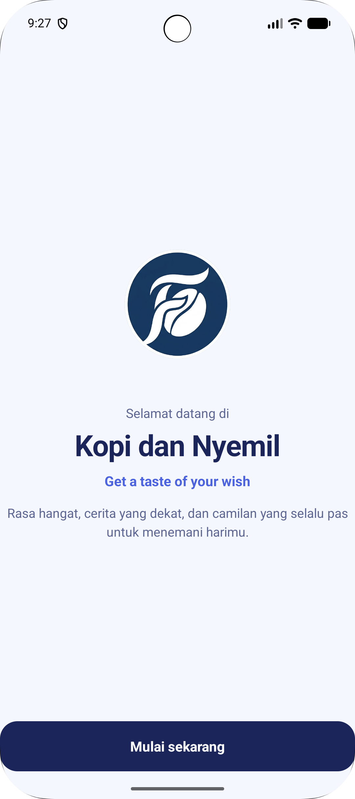
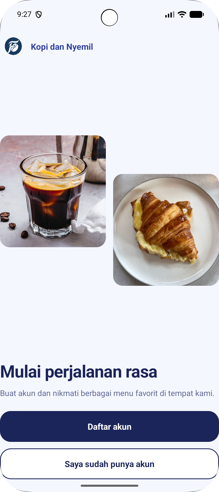
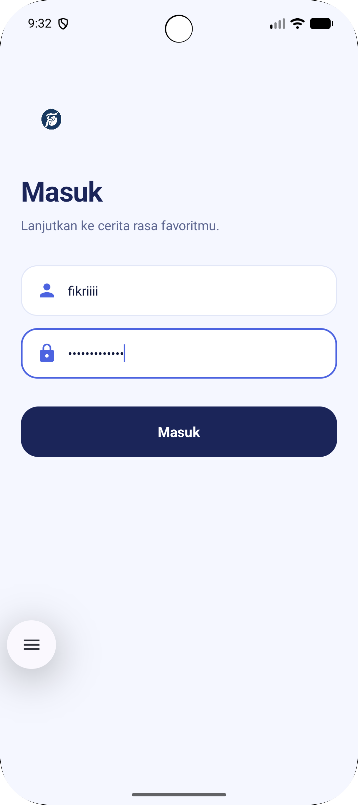
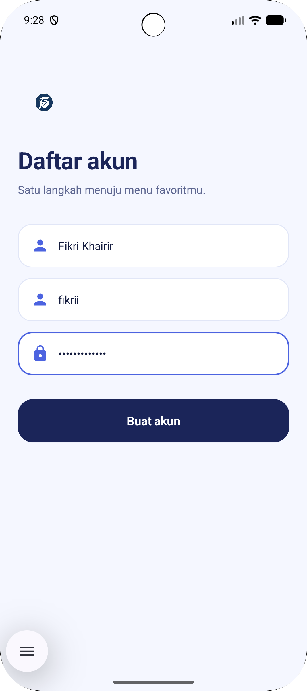
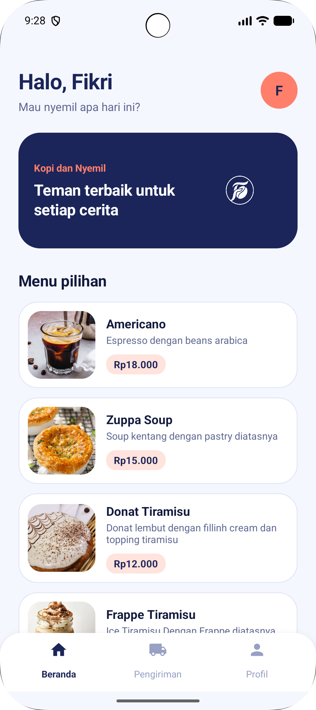
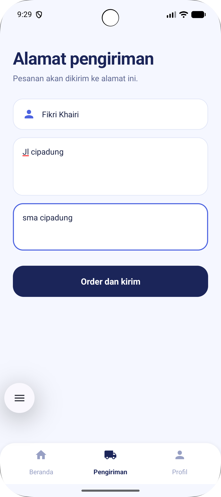
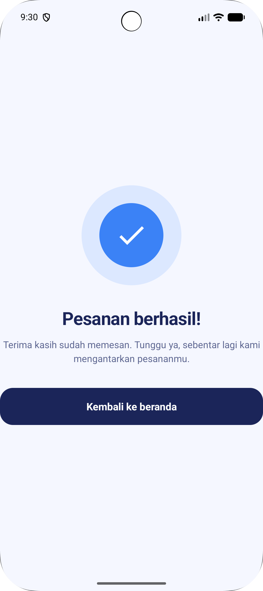
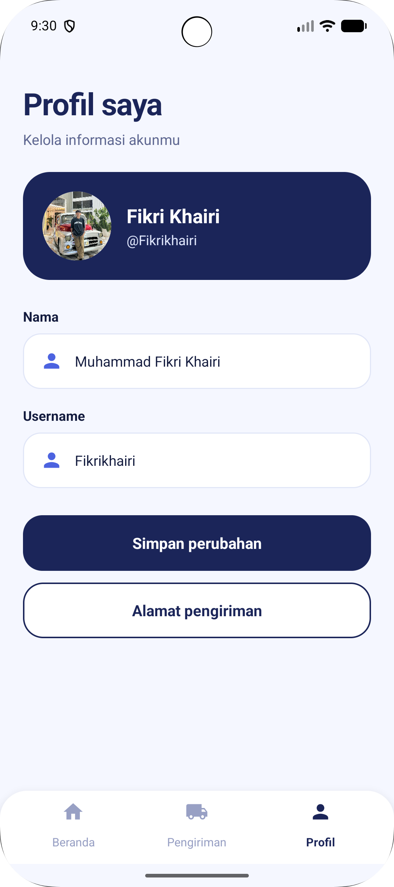

# Kopi dan Nyemil

Aplikasi Android untuk memesan kopi dan camilan. Pengguna dapat membuka aplikasi, mendaftar atau masuk, melihat daftar menu, mengisi alamat pengiriman, lalu menyelesaikan pesanan. Proyek ini dibuat sebagai tugas UTS.

> **Tagline:** *Get a taste of your wish*

## Deskripsi

**Kopi dan Nyemil** adalah prototipe aplikasi pemesanan makanan dan minuman dengan tampilan modern berbasis biru indigo dan aksen koral. Seluruh antarmuka dibuat dengan layout XML dan setiap layar dihubungkan oleh `Activity` Kotlin.

Aplikasi ini berfokus pada **alur dan tampilan (UI/UX)**. Data menu masih statis di layout, dan proses daftar atau masuk belum terhubung ke server maupun database.

## Fitur

- **Splash screen** dengan logo, yang otomatis pindah ke halaman sambutan.
- **Halaman sambutan (Welcome)** dengan pengenalan singkat aplikasi.
- **Daftar akun dan masuk** dengan formulir nama, username, dan password.
- **Beranda** berisi sapaan, banner, dan daftar menu pilihan lengkap dengan foto, deskripsi, dan harga.
- **Pesan sekarang**, yang mengarahkan pengguna ke halaman alamat pengiriman.
- **Alamat pengiriman** dengan isian nama, alamat lengkap, dan patokan.
- **Konfirmasi pesanan** yang menampilkan pesan berhasil, lalu kembali ke beranda.
- **Profil** berisi foto, nama, dan username, serta tombol simpan perubahan.
- **Navigasi bawah** (Beranda, Pengiriman, Profil) untuk berpindah halaman dengan cepat.

### Daftar menu

| Menu | Deskripsi | Harga |
|---|---|---|
| Americano | Espresso dengan beans arabica | Rp18.000 |
| Zuppa Soup | Soup kentang dengan pastry di atasnya | Rp15.000 |
| Donat Tiramisu | Donat lembut dengan filling cream dan topping tiramisu | Rp12.000 |
| Frappe Tiramisu | Ice tiramisu dengan frappe di atasnya | Rp25.000 |
| Croissant Keju | Croissant dengan filling keju | Rp23.000 |

### Alur aplikasi

```
Splash → Welcome → Signup ─┬─ Daftar akun (Register) ─┐
                           └─ Masuk (Login) ──────────┤
                                                      ▼
                                                    Home ──► Alamat (Address) ──► Konfirmasi
                                                      │            ▲
                                                      └── Profil ──┘
```

## Teknologi yang Digunakan

| Komponen | Keterangan |
|---|---|
| Bahasa | Kotlin |
| UI | Android Views (layout XML), `ScrollView`, `LinearLayout`, `ConstraintLayout` |
| Library | AndroidX Core KTX, AppCompat, Activity KTX, Material Components, ConstraintLayout |
| Build system | Gradle (Kotlin DSL) dengan Version Catalog (`libs.versions.toml`) |
| Android Gradle Plugin | 9.3.3 |
| Gradle | 9.5.0 |
| Compile / Target SDK | 37 |
| Min SDK | 27 (Android 8.1) |
| IDE | Android Studio |

### Versi library

| Library | Versi |
|---|---|
| `androidx.core:core-ktx` | 1.19.1 |
| `androidx.appcompat:appcompat` | 1.8.0 |
| `androidx.activity:activity-ktx` | 1.13.0 |
| `androidx.constraintlayout:constraintlayout` | 2.2.2 |
| `com.google.android.material:material` | 1.14.0 |

## Struktur Proyek

```
UtsFikri/
├── app/
│   └── src/main/
│       ├── java/lat/pam/utsfikri/
│       │   ├── SplashActivity.kt
│       │   ├── WelcomeActivity.kt
│       │   ├── SignupActivity.kt
│       │   ├── RegisterActivity.kt
│       │   ├── LoginActivity.kt
│       │   ├── HomeActivity.kt
│       │   ├── AddressActivity.kt
│       │   ├── ConfirmationActivity.kt
│       │   └── ProfileActivity.kt
│       ├── res/
│       │   ├── layout/      # activity_*.xml
│       │   ├── drawable/    # ikon, bentuk, dan gambar menu
│       │   └── values/      # colors, styles, themes, strings
│       └── AndroidManifest.xml
├── gradle/libs.versions.toml
├── build.gradle.kts
└── settings.gradle.kts
```

## Cara Menjalankan Aplikasi

### Prasyarat

- [Android Studio](https://developer.android.com/studio) versi terbaru.
- Android SDK 37 (dapat diunduh lewat **SDK Manager**).
- JDK 25. Gradle akan mengunduhnya otomatis pada sinkronisasi pertama, jadi pastikan koneksi internet aktif.
- Emulator atau perangkat Android dengan Android 8.1 (API 27) atau lebih baru.

### Langkah-langkah

1. **Unduh proyek**, lalu ekstrak jika berbentuk ZIP.
   ```bash
   git clone https://github.com/fikrikhairi1205/UtsFikri.git
   ```
2. **Buka di Android Studio** melalui **File → Open**, lalu pilih folder `UtsFikri` (folder yang langsung berisi `settings.gradle.kts`).
3. **Tunggu sinkronisasi Gradle** selesai. Pada percobaan pertama prosesnya bisa cukup lama karena mengunduh dependensi.
4. **Siapkan emulator** lewat **Device Manager → Create Device** (misalnya Pixel), atau sambungkan perangkat Android dengan USB debugging aktif.
5. **Jalankan aplikasi** dengan menekan tombol **Run ▶** atau `Shift + F10`.

## Screenshot

|              Splash               |               Welcome                | Signup |
|:---------------------------------:|:------------------------------------:|:---:|
|  |  |  |

|              Masuk              | Daftar | Beranda |
|:-------------------------------:|:---:|:---:|
|  |  |  |

|               Menu               | 
|:--------------------------------:|
| .png) | 


|         Alamat Pengiriman          |                Konfirmasi                 | Profil |
|:----------------------------------:|:-----------------------------------------:|:---:|
|  |  |  |

## Pengembang

**Muhammad Fikri Khairi 1247050107**

Proyek UTS: `lat.pam.utsfikri`